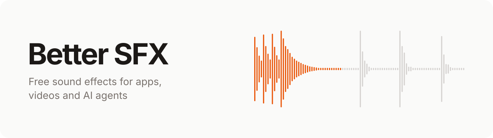
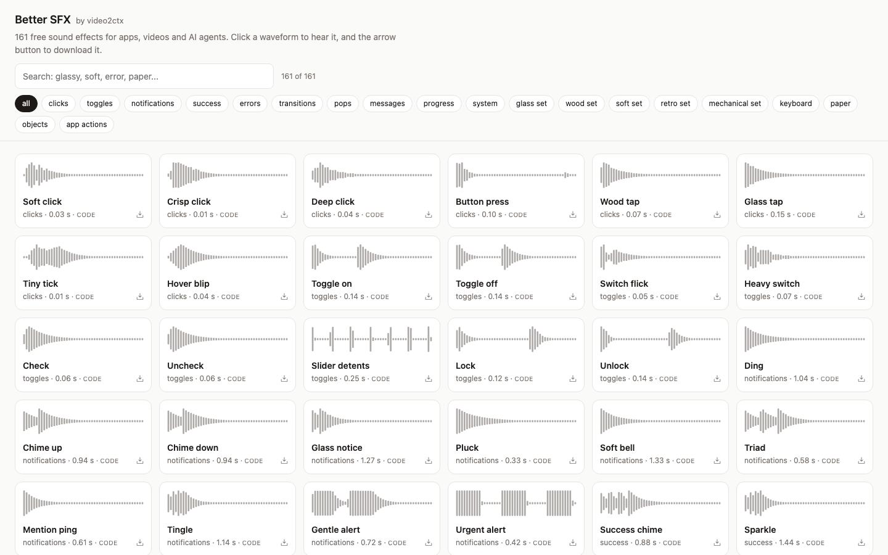

<p align="center">
  <a href="https://sfx.video2ctx.dev">
    <picture>
      <source media="(prefers-color-scheme: dark)" srcset="https://raw.githubusercontent.com/devhims/better-sfx/main/.github/banner-dark.svg">
      <source media="(prefers-color-scheme: light)" srcset="https://raw.githubusercontent.com/devhims/better-sfx/main/.github/banner-light.svg">
      
    </picture>
  </a>
</p>

<p align="center">
  <a href="https://sfx.video2ctx.dev"></a>
  
  <a href="#use-it-with-your-agent"></a>
  <a href="#license"></a>
  <a href="LICENSE"></a>
</p>

<p align="center">
  <a href="https://sfx.video2ctx.dev"><strong>Browse the sounds</strong></a> ·
  <a href="#use-it-with-your-agent">Agent skill</a> ·
  <a href="#use-it-in-code">Use it in code</a> ·
  <a href="#license">License</a>
</p>

Better SFX is a library of 161 short sound effects for apps, websites, videos and AI agents, made by [video2ctx](https://www.video2ctx.dev). Play any sound in your browser at [sfx.video2ctx.dev](https://sfx.video2ctx.dev) and download it as WAV or M4A, or install the agent skill and let your agent find and add the right sounds for you.

<picture>
  <source media="(prefers-color-scheme: dark)" srcset="https://raw.githubusercontent.com/devhims/better-sfx/main/.github/screenshot-dark.png">
  
</picture>

## Why Better SFX

- **Ready to drop in.** Files are trimmed close to their onset, with faint lead-ins, long silent gaps and stray second takes removed where appropriate. Swells and rhythmic sounds keep their natural timing.
- **Matched in loudness.** A click and a notification play at a consistent level, so nothing jumps out of a mix.
- **Sets that belong together.** Five matching sets cover the same ten app actions in one voice each, so a whole app can sound consistent.
- **Made for agents.** An agent skill, a JSON catalog and an `llms.txt` file let an agent search the library and add sounds without a person picking files.
- **Free for commercial use.** No account, no credit required, no fees per use.

## What's inside

| Group | Sounds | Examples |
| --- | ---: | --- |
| [Matching UI sound sets](https://sfx.video2ctx.dev/apps/) | 50 | Glass, wood, soft, retro and mechanical, each with click, hover, toggle, notify, success, error, open, close, send and delete |
| Clicks and toggles | 17 | Soft click, wood tap, toggle on, lock |
| Notifications and messages | 14 | Ding, chime up, mention ping, receive |
| Success, errors and progress | 19 | Success chime, level up, error buzz, countdown |
| [Transitions and pops](https://sfx.video2ctx.dev/video/) | 14 | Fast swoosh, deep whoosh, riser, pop, bubble |
| System | 6 | Power on, startup chord, connect |
| Keyboard and paper foley | 15 | Mechanical key, laptop typing, page turn, paper crumple |
| Objects and app actions | 26 | Camera shutter, coin drop, cash register, scissors snip, sticky note |

Every sound comes as a WAV (48 kHz, 16-bit mono) and an M4A (128 kbps), each with its own page, tags and description.

## Use it with your agent

Install the Better SFX skill in Claude Code, Codex or any agent that supports [Agent Skills](https://agentskills.io):

```bash
npx skills add devhims/better-sfx
```

Then ask for the sound you want in plain words:

```text
Add a soft, glassy success sound to the checkout button.
Use the wood set for every button sound in this app.
Put a whoosh on each cut in this video.
```

The skill searches the library, shows you a few candidates when the choice is a matter of taste, downloads the files into your project and wires them up. In a web app it adds a small player with a mute setting. In a video edit it places each sound on its cue, either with ffmpeg or as a cue list for your editor.

## Use it in code

Download the sounds you need into your project's static folder, then play them on a user action:

```js
const click = new Audio('/sounds/glass-click.m4a');

button.addEventListener('click', () => {
  click.currentTime = 0;
  click.play();
});
```

Every sound also has a stable URL, which is handy for prototypes and for agents:

| What | URL |
| --- | --- |
| Sound page | `https://sfx.video2ctx.dev/sound/<id>/` |
| WAV file | `https://sfx.video2ctx.dev/sounds/<id>.wav` |
| M4A file | `https://sfx.video2ctx.dev/sounds/<id>.m4a` |
| Every sound, with tags and durations | [`catalog.json`](https://sfx.video2ctx.dev/catalog.json) |
| A summary for language models | [`llms.txt`](https://sfx.video2ctx.dev/llms.txt) |

## License

| Part | License | In short |
| --- | --- | --- |
| The sounds | [Better SFX License](LICENSE-SOUNDS.txt) | Free for personal and commercial use, no credit required. You cannot resell or redistribute the sounds on their own, and nobody may register them with YouTube Content ID. |
| The code and the agent skill | [MIT](LICENSE) | Use, change and share it, keeping the copyright notice. |

## How the sounds are made

- **121 sounds are made in code** with the Web Audio API. Each one is a short recipe in [`src/synth-recipes.mjs`](src/synth-recipes.mjs) or [`src/set-recipes.mjs`](src/set-recipes.mjs), drawn with the toolkit in [`src/kit.mjs`](src/kit.mjs).
- **40 sounds are recordings** generated with Higgsfield Seed Audio 1.0 from the prompts in [`src/seed-prompts.mjs`](src/seed-prompts.mjs). The takes the build uses are in [`recordings/`](recordings/).

[`src/finish.mjs`](src/finish.mjs) cleans every sound the same way: it keeps the main event, drops faint lead-ins and second takes, shortens silent gaps, fades the ends and matches loudness.

## Development

Requires Node.js 22+ and ffmpeg.

```bash
npm install
npm run build    # renders every sound, writes dist/ and the website
npm run dev      # regenerates the site and serves it at http://127.0.0.1:4321
npm run check    # type check
npm test         # skill and preview-server regression tests
npm run audit    # lead-in, tail and silent gaps for each recording
```

`dist/` is the website and is committed, so it can be deployed as static files without running the build. New recordings need the [Higgsfield CLI](https://higgsfield.ai) and credits: `npm run generate` makes a take for every prompt that has none, and `npm run generate -- <id>` makes a new take of one sound.

<details>
<summary>Project layout</summary>

| Path | What it holds |
| --- | --- |
| `src/kit.mjs` | Web Audio toolkit: tones, filtered noise, struck materials, FM and reverb |
| `src/synth-recipes.mjs` | Standalone sounds made in code |
| `src/set-recipes.mjs` | The five matching sets: one style each, the same ten actions |
| `src/seed-prompts.mjs` | Seed Audio prompts and per-sound cleanup settings |
| `src/finish.mjs` | Trimming, gap closing, fades and loudness |
| `src/build.mjs` | Renders everything into `dist/` |
| `src/site.mjs` | Generates the website, sitemap, robots.txt and llms.txt |
| `src/banner.mjs` | Draws the README banner from real waveforms |
| `src/serve.mjs` | Local preview server for `npm run dev` |
| `src/license.mjs` | The sound license text, used by the site and LICENSE-SOUNDS.txt |
| `recordings/` | The Seed Audio takes the build uses, as lossless FLAC |
| `skills/better-sfx/` | The agent skill |
| `types/` | Shared types for the type check |

</details>

## Credits

Icons are from [Phosphor](https://phosphoricons.com) (MIT). Recordings are generated with [Higgsfield](https://higgsfield.ai) Seed Audio 1.0.

<p align="center">
  Made by <a href="https://www.video2ctx.dev">video2ctx</a>
</p>
